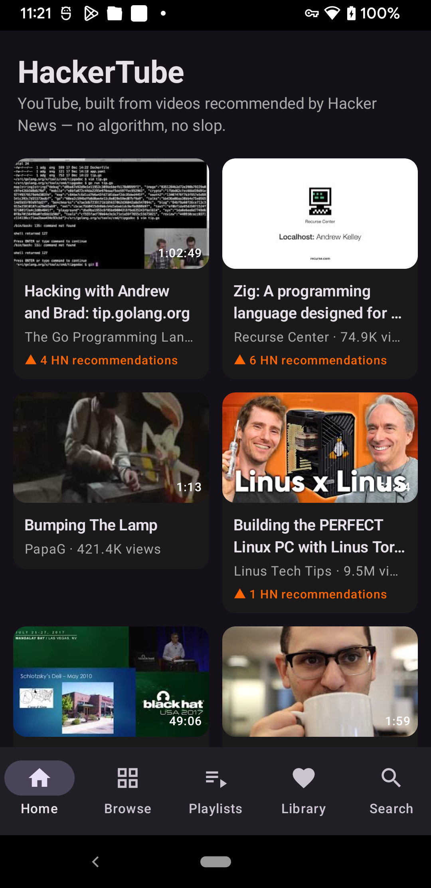
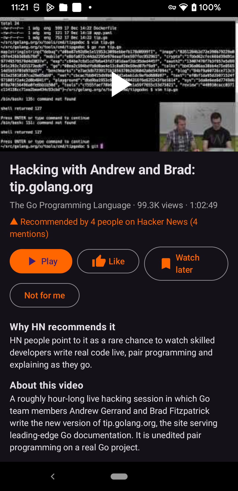
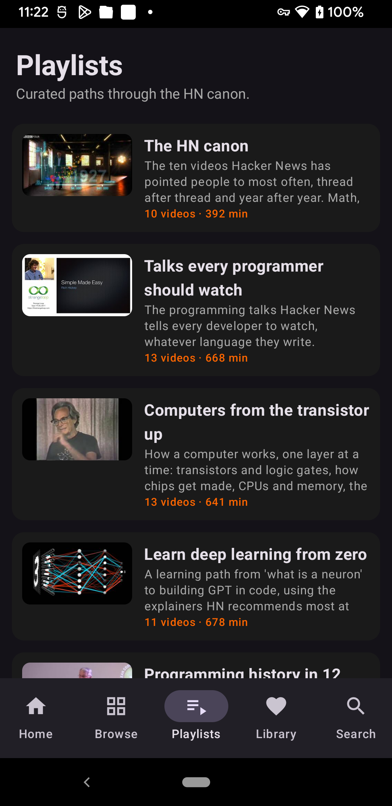

# HackerTube for Android

**YouTube, built from videos recommended by Hacker News — now as a native Android app.**

[](LICENSE)
[](#install)

On 31 October 2026, [Andrej Karpathy](https://x.com/karpathy/status/2116957135661945283) got tired of YouTube's "enshittified wall of slop" and built [HackerTube](https://hackertube.org) in about two hours: **6,454 videos** that Hacker News users actually recommended across **39,834 comments from 2007–2026**, organised into **150 topics**. No engagement algorithm. No accounts. No tracking.

This project brings HackerTube to **Android phones and tablets first** — the place most people actually watch video — with Android TV / Google TV support in the same APK.

> Not affiliated with Andrej Karpathy, Hacker News / Y Combinator, or YouTube / Google. Curation data comes from the public [hackertube.org](https://hackertube.org) API. Videos play in the official YouTube app.

## Screenshots

| Home feed | Why HN recommends it | Playlists |
|---|---|---|
|  |  |  |

Real screenshots from a physical device, live data from hackertube.org — no mockups.

## Why another client?

| | hackertube.org (web) | hackertube.tv (TV client) | **HackerTubeApps (this repo)** |
|---|---|---|---|
| Phone / tablet | Browser only | ❌ | ✅ Native Compose app |
| Android TV / Google TV | ❌ | ✅ TV-first | ✅ Same APK, leanback launcher |
| Offline first launch | ❌ | ❌ | ✅ Bundled HN classics |
| Liked / Watch later / History | Browser storage | On TV | On device, no account |
| Open source | Data downloadable | MIT | **MIT** |

## Features (v0.1.0)

- **Home feed** — the HackerTube feed, with topic context on every card
- **Search** — search only the 6,454 HN-recommended videos, nothing else
- **Browse** — all topic areas and categories from `/api/browse`
- **Playlists** — curated paths like *The HN canon* and *Talks every programmer should watch*
- **Video detail** — summary, **why HN recommends it**, real HN quotes, recommendation count, tags, and up-next videos
- **Library** — Liked, Watch later and History, stored **only on your device**
- **Playback** — tap a video and it plays in the official YouTube app (phone) or YouTube for TV; press Back and you are back in HackerTube
- **Not for me** — hide a video from your feed, locally
- **No account, no ads, no tracking SDKs** — the only network calls are to `hackertube.org` and YouTube thumbnail CDN

## Install

### From a release APK

1. Download `app-release.apk` from the [latest release](https://github.com/nickylin/HackerTubeApps/releases).
2. Install it on any Android 8.0+ phone, tablet, Android TV or Google TV device.
   - TV: `adb connect <tv-ip>:5555` then `adb install app-release.apk` (enable developer options / network debugging first).

> A Google Play listing is planned — see [docs/PLAY_STORE.md](docs/PLAY_STORE.md). The open-source APK will always remain free.

### Build from source

Requirements: JDK 17 and Android SDK (platform 34), or just open the project in Android Studio.

```bash
git clone https://github.com/nickylin/HackerTubeApps.git
cd HackerTubeApps
./gradlew assembleRelease
adb install app/build/outputs/apk/release/app-release.apk
```

The release build is signed with the debug key on purpose (same approach as other open HackerTube clients) so anyone can install a from-source build without extra setup.

## How it works

The app is a thin, native client for the same public JSON API the HackerTube website uses:

| Endpoint | Used for |
|---|---|
| `GET /api/feed` | Home feed |
| `GET /api/list` | Category filtering |
| `GET /api/search?q=…` | Search |
| `GET /api/video?vid=…` | Video detail |
| `GET /api/related?vid=…` | Up next |
| `GET /api/browse` | Topic areas & categories |
| `GET /api/playlists` / `GET /api/playlist?slug=…` | Playlists |

Built with **Kotlin + Jetpack Compose (Material 3)** in a single module, with zero tracking/analytics dependencies. Networking uses the platform HTTP stack; thumbnails load via Coil from YouTube's CDN.

## Roadmap

See [docs/ROADMAP.md](docs/ROADMAP.md). Short version: native Compose for TV UI, semantic search, downloads of the full offline dataset, widgets, and a Google Play release.

## Credits

- [Andrej Karpathy](https://karpathy.bearblog.dev) — created HackerTube and released its data ([announcement](https://x.com/karpathy/status/2116957135661945283), [HN thread](https://news.ycombinator.com/item?id=50319510))
- [hackertube.org](https://hackertube.org) — videos, summaries and curation
- [ephraimduncan/hackertube.tv](https://github.com/ephraimduncan/hackertube.tv) — the first Android TV client, shipped within a day; this project takes the idea to phones and tablets
- Hacker News community — twenty years of recommendations

## Contributing

Issues and PRs welcome. Good first contributions: TV focus handling, translations, and screenshot tests. Please keep the "no tracking, no account" rule intact.

## License

[MIT](LICENSE). HackerTube curation data belongs to its creators; YouTube™ and Android™ are trademarks of Google LLC; Hacker News is a trademark of Y Combinator.
